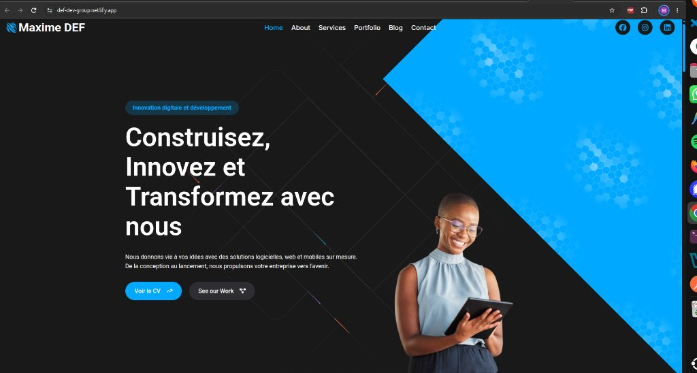
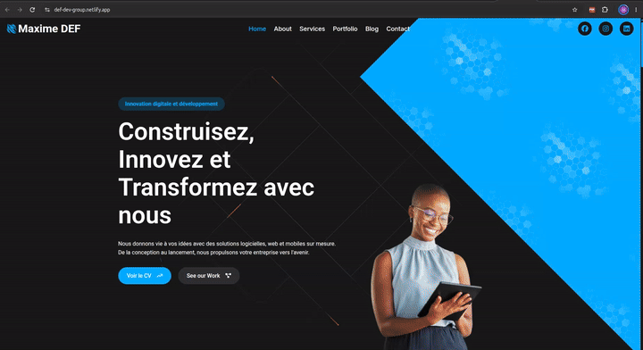

# Maxime DEF - Digital Innovation & Development Agency

Site vitrine moderne et interactif concu pour une agence digitale et studio de developpement de solutions web et logicielles sur mesure. Developpee avec React et Vite, l'application met en valeur les expertises techniques, les realisations et les services a travers une experience utilisateur immersive et des animations soignees.

- **Demonstration en ligne** : [https://def-dev-group.netlify.app](https://def-dev-group.netlify.app)
- **Auteur** : Maxime DEFALEOUNA

---

## Apercu du Projet

### Capture de la Page d'Accueil
Interface principale sombre avec accents bleus, typographie epuree et mise en valeur des axes strategiques.



### Demonstration des Interactions
Apercu des animations au defilement, compteurs dynamiques et carrousels interactifs.



La video complete de demonstration (screencast) est egalement disponible dans le depot :
[Visionner la video complete de demonstration](demo/screencast.mp4)

---

## Fonctionnalites Principales

### Experience Utilisateur et Animations
- **Animations fluides au scroll** : Integration de la bibliotheque GSAP (GreenSock) pour des apparitions progressives et des transitions de qualite.
- **Compteurs dynamiques** : Chiffres cles animes via Odometer lors du passage sur la section des accomplissements.
- **Carrousels interactifs** : Sliders tactiles et responsives propulses par Swiper pour la vitrine des projets et les temoignages clients.
- **Navigation fluide** : Defilement continu entre les sections grace a `react-scroll`.

### Sections du Site
- **Hero** : En-tete immersif avec accroche, presentation des services phares et boutons d'appel a l'action (Consultation de CV et Projets).
- **Accomplissements (Achievements)** : Statistiques cles et metriques de performance.
- **A Propos (About)** : Vision technologique, engagements et methodologie de travail.
- **Services** : Detail des prestations proposees (solutions web, cloud, developpement mobile, cybersecurite).
- **Portfolio** : Galerie dynamique des projets realises avec filtres et previsualisations.
- **Temoignages (Testimonials)** : Retours et avis clients sous forme de carrousel.
- **Blog** : Derniers articles et veille technologique.
- **Formulaire de Contact** : Formulaire fonctionnel connecte a l'API Formspree pour la reception instantanee des demandes.
- **Footer** : Liens rapides, souscription a la newsletter et coordonnees.

---

## Stack Technique

| Categorie | Technologies |
| :--- | :--- |
| **Framework & Environnement** | React 18, Vite 5 |
| **Animations & Effets** | GSAP (@gsap/react), React Odometer, Swiper 11 |
| **Navigation & Requetes** | React Scroll, Axios, Formspree API |
| **Styles & Icones** | CSS3 moderne (Variables CSS personnalisees), React Icons |
| **Qualite de code** | ESLint |
| **Deploiement & Hebergement**| Netlify (Integration continue CI/CD) |

---

## Installation et Execution en Local

### 1. Prerequis
- Node.js (version 18 ou superieure recommandee)
- npm ou yarn

### 2. Cloner le depot
```bash
git clone https://github.com/maximedefaleouna/agency.git
cd agency
```

### 3. Installer les dependances
```bash
npm install
```

### 4. Lancer le serveur de developpement
```bash
npm run dev
```
L'application demarrera localement, generalement accessible a l'adresse `http://localhost:5173`.

### 5. Compiler pour la production
```bash
npm run build
```
Les fichiers optimises pour la mise en ligne seront generes dans le repertoire `dist/`.

---

## Deploiement

Le projet est configure pour un deploiement automatique sur Netlify a chaque mise a jour de la branche principale `main`.
Pour tester le build de production localement :
```bash
npm run preview
```

---

## Auteur

**Maxime DEFALEOUNA**
- Portfolio en ligne : [https://def-dev-group.netlify.app](https://def-dev-group.netlify.app)
- GitHub : [@maximedefaleouna](https://github.com/maximedefaleouna)
